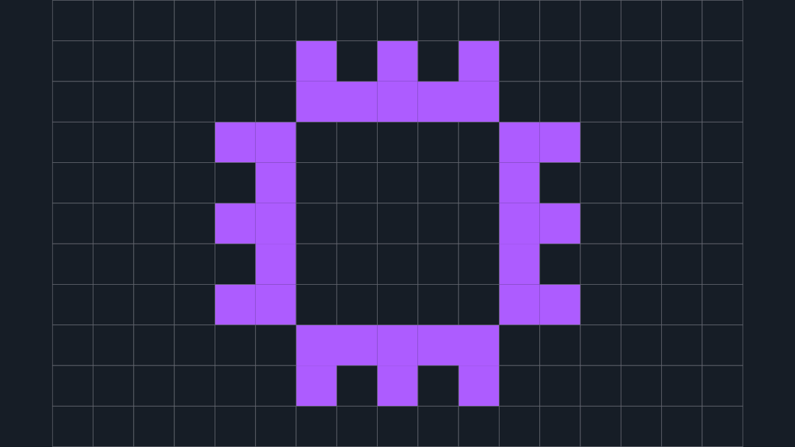

# AWS Student Builder Group — COMSATS University Islamabad
### Premium Event Spin Wheel & Lucky Draw Platform



A production-ready, cryptographically fair, projector-optimized lucky draw web application built for **AWS Student Builder Group — COMSATS University Islamabad** events, cloud workshops, and student community gatherings.

---

## ✨ Key Features

- **Authentic AWS Cloud Club Visual Identity**: Designed around the official AWS Cloud Club dark banner (`16:9` aspect ratio preserved without distortion) and a deep Midnight Violet palette (`#090714` base, `#151027` elevated surfaces, `#8B5CF6` & `#A855F7` purple accents).
- **Cinematic Introductory Splash Screen**: 1.8-second animated brand reveal that respects `prefers-reduced-motion: reduce` and degrades gracefully on slow connections.
- **Cryptographically Fair Selection Engine**: Uses the Web Crypto API (`window.crypto.getRandomValues(new Uint32Array(1))`) with strict **rejection sampling** to eliminate modulo bias. Every eligible student has an exact `1 / N` probability of winning.
- **60 FPS High-DPI HTML5 2D Canvas Wheel**: Smooth multi-stage deceleration over 6 seconds (`7–9` full revolutions) with physical top-pointer spring deflection and perimeter LED indicators.
- **Adaptive Large-Cohort Scaling (`1` to `1,000+` Students)**: When a Google Sheet exceeds `48` eligible students, the cryptographic draw still selects fairly from **100% of the eligible pool** while constructing a legible `48`-slice stage display window containing the selected winner.
- **Live Google Forms & Google Sheets Integration**:
  - Pre-configured for the official event Google Sheet (`1hOghDsBghg1m8VNGH4LR-P5US2uGn6XNNhzQ6E1ga_Q`).
  - Uses scoped Google Visualization queries (`tq=SELECT B, C`) so `Email` (Column D) and survey answers (Column E) are excluded at the Google server level.
  - Deduplicates repeat submissions using one-way hashes of normalized student registration numbers (`Reg No`), while **preserving different students who share identical names**.
  - Includes a ready-to-deploy **Google Apps Script Web App (`google-apps-script/Code.gs`)** for private-sheet server-side deployment.
- **Procedural Web Audio Synthesizer**: Zero-dependency `AudioContext` sound engine producing mechanical peg ticks, spin launch chimes, and a celebratory winner chord fanfare with global Mute/Unmute controls.
- **Organizer Controls Drawer**:
  - Live sheet refresh with automatic stale-cache preservation if auditorium Wi-Fi drops.
  - **Exclude Previous Winners** (enabled by default for the current session).
  - **Session Winner History** with spin sequence numbers (`#1`, `#2`, ...), timestamps, and `.csv` export.
  - **Fullscreen Presentation Mode** for auditorium projectors.
  - **PIN-Protected Administrative Actions** (default PIN: `2026`) for resetting session history and toggling the explicitly labeled **Development / Test Sandbox Mode** (`1`, `2`, `12`, `24`, `128`, or `500` mock students).

---

## 📁 Project Architecture

```text
├── ai_docs/                          # Complete Phase 0-13 Engineering Documentation
│   ├── 00_PROJECT_OVERVIEW.md
│   ├── 01_REQUIREMENTS.md
│   ├── 02_FEATURE_SPECIFICATIONS.md
│   ├── 03_DESIGN_SYSTEM.md
│   ├── 04_SYSTEM_ARCHITECTURE.md
│   ├── 05_GOOGLE_SHEETS_INTEGRATION.md
│   ├── 06_SPIN_WHEEL_ALGORITHM.md
│   ├── 07_DEVELOPMENT_PHASES.md
│   ├── 08_TASK_TRACKER.md
│   ├── 09_PROGRESS_LOG.md
│   ├── 10_TESTING_PLAN.md
│   ├── 11_SECURITY_GUIDELINES.md
│   ├── 12_AWS_AMPLIFY_DEPLOYMENT.md
│   └── 13_ADMIN_USER_GUIDE.md
├── google-apps-script/
│   └── Code.gs                       # Optional Server-Side Google Apps Script Web App
├── public/
│   └── assets/
│       └── Banner_Cloud_Club_Dark.svg
├── src/
│   ├── components/
│   │   ├── controls/                 # OrganizerPanel & WinnerHistoryCard
│   │   ├── layout/                   # Header, AmbientBackground, ErrorBoundary, Footer
│   │   ├── splash/                   # SplashScreen
│   │   ├── wheel/                    # SpinWheelCanvas & WheelStatusBar
│   │   └── winner/                   # WinnerModal & ConfettiOverlay
│   ├── hooks/                        # useLuckyDraw, useFullscreen, useReducedMotion
│   ├── services/                     # participantService & soundService
│   ├── styles/                       # Tailwind CSS & custom scrollbars
│   ├── types/                        # Strict TypeScript interfaces
│   ├── utils/                        # cryptoRandom, csvParser, storage, sandboxData
│   ├── App.tsx
│   └── main.tsx
├── tests/
│   ├── unit/                         # Vitest + React Testing Library suites
│   └── e2e/                          # Playwright multi-viewport E2E tests
├── .env.example
├── amplify.yml                       # AWS Amplify Hosting CI/CD build spec
├── package.json
└── vite.config.ts
```

---

## 🚀 Quick Start & Local Development

### 1. Install Dependencies
```bash
npm install
```

### 2. Configure Environment Variables (Optional)
Copy `.env.example` to `.env` if you want to override the default connected Google Sheet ID or Organizer PIN:
```env
VITE_GOOGLE_SHEET_ID=1hOghDsBghg1m8VNGH4LR-P5US2uGn6XNNhzQ6E1ga_Q
VITE_SHEET_NAME_COLUMN=Name
VITE_SHEET_ID_COLUMN=Reg No
VITE_PARTICIPANTS_API_URL=
VITE_ORGANIZER_PIN=2026
```

### 3. Run Development Server
```bash
npm run dev
```
Open `http://localhost:5173`.

### 4. Run Automated Tests
```bash
# Run Vitest unit & component integration tests
npm run test

# Run Playwright E2E multi-viewport browser tests
npm run test:e2e
```

### 5. Build for Production
```bash
npm run build
```

---

## ☁️ Deploying to AWS Amplify Hosting

1. Push this repository to GitHub (`https://github.com/ranaaalihaider/spinwheel.git`).
2. In the **AWS Amplify Console**, click **Create new app** → select **GitHub** → choose `ranaaalihaider/spinwheel` (`main` branch).
3. AWS Amplify automatically detects `amplify.yml` in the root directory (`npm ci` → `npm run build` → `dist/`).
4. Set environment variables in the Amplify Console if customizing `VITE_GOOGLE_SHEET_ID` or `VITE_ORGANIZER_PIN`.
5. Click **Save and deploy**. Every subsequent push to `main` triggers an automatic zero-downtime deployment.

See [`ai_docs/12_AWS_AMPLIFY_DEPLOYMENT.md`](./ai_docs/12_AWS_AMPLIFY_DEPLOYMENT.md) and [`ai_docs/13_ADMIN_USER_GUIDE.md`](./ai_docs/13_ADMIN_USER_GUIDE.md) for full operational details.
